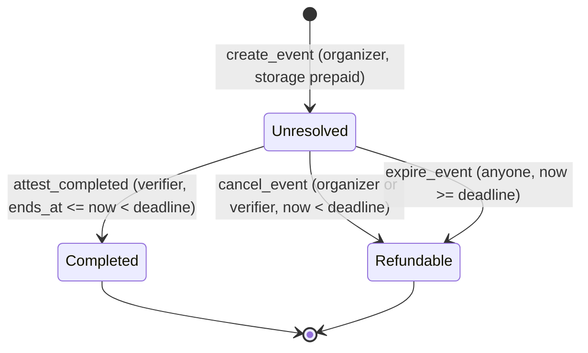
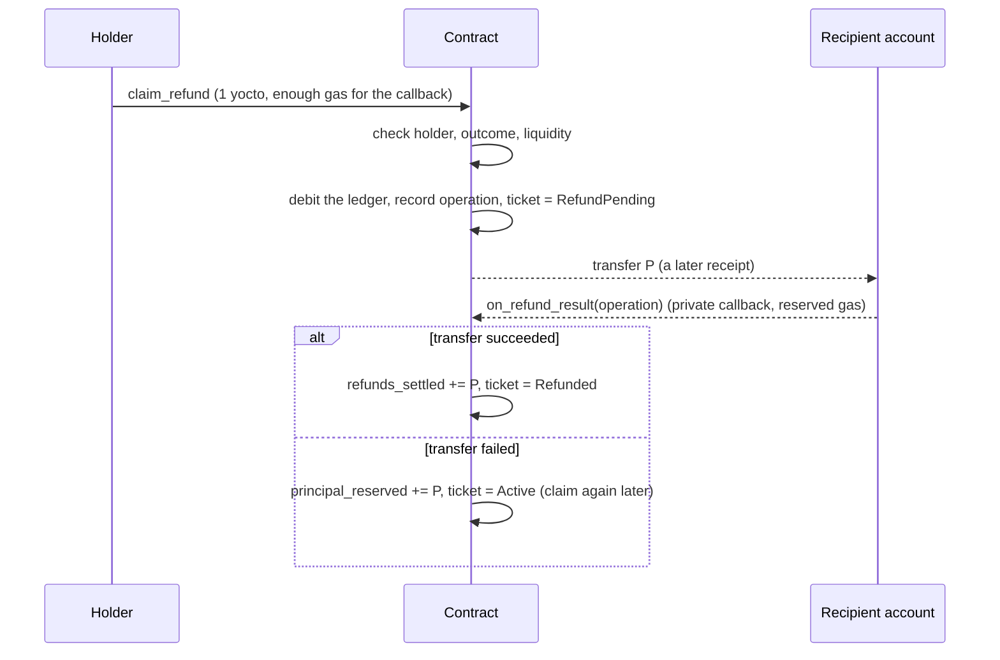

# Design

How the contract works and why it is built this way. The exact method signatures, JSON shapes and error codes are in the frozen interface, in two parts: [events, tickets and payments in NEAR](plans/2026-11-12-ticket-escrow-mvp-plan.md#frozen-interface-v1), and [currencies, the ticket's computed text and picture, and the entry pass](plans/2026-11-13-pass-group-verifier-dollars.md#frozen-interface-v2); every way to cheat we could think of, with the test that stops it, is in the [threat model](threat-model.md).

## The idea in one paragraph

When you buy a ticket today, the money goes to the seller, and a refund is a promise that depends on the seller still having it. Here the price never reaches the organizer until the event has been confirmed. It stays reserved in a contract, attached to the ticket. If the event is cancelled, or the deadline passes and nobody confirmed it, whoever holds the ticket at that moment takes the money back, without asking the organizer, the ticketing site or us.

## Who can do what

| Actor | Can | Cannot |
|---|---|---|
| Organizer | Create an event with fixed terms and prepay its storage. Cancel it. Collect after it is confirmed. | Change the terms. Touch the money before confirmation. Confirm their own event. |
| Verifier | Accept the terms before any ticket is sold. Confirm the event took place, after it ends and before the deadline. Cancel it. | Receive money. Confirm early or late. Be the organizer. |
| Buyer | Buy at exactly the price while the event is on sale. | Pay more or less than the price. Buy before the verifier accepted. |
| Holder | Transfer the ticket before the event starts. Claim the refund when the event is refundable. | Claim twice. Claim after transferring the ticket away. |
| Anyone | Switch an unresolved event to refunds once the deadline has passed. Read everything. | Anything else. There is no owner, no admin and no upgrade method. |

The verifier is the one party you must trust, and the contract says so instead of hiding it: a verifier who lies and confirms an event that never happened releases the money to the organizer (test `t21_false_attestation_is_a_trust_limit`). What the design removes is the need to trust the organizer, and the need for anybody to act for a refund to become possible.

## The rules

| Id | Rule |
|---|---|
| R1 | Each ticket records a fixed principal `P`, the price paid. Its current holder owns the right to the refund of exactly `P`. |
| R2 | An event is `Unresolved` until exactly one of: the verifier confirms it between its end and the deadline (`Completed`); the organizer or the verifier cancels it before the deadline (`Refundable`); anyone expires it once the deadline has passed (`Refundable`). The outcome never changes again. |
| R3 | The organizer cannot receive anything while the event is `Unresolved` or `Refundable`. |
| R4 | Tickets are sold only after the verifier accepted the exact terms, at exactly the price, before the start and within capacity. |
| R5 | Terms never change after creation. |
| R6 | A ticket can be transferred by its holder only while the event is `Unresolved`, before it starts, and while the ticket has no pending operation. |
| R7 | Settlement reserves first: the right is debited and a pending operation recorded before the transfer is scheduled; a private callback confirms on success and restores on a confirmed failure; nothing is retried on a timer. |
| R8 | While a ticket has a pending refund or an unresolved transfer to a contract, it cannot be transferred or refunded. |
| R9 | The organizer prepays storage for the whole capacity at creation. Ticket money never pays for storage, and one event can never spend another event's principal. |
| R10 | The contract has no owner, no admin method, no upgrade method and no way to move principal outside R1–R8. The final deployment has zero access keys. |
| R11 | The event outcome and each payment's result are separate facts: `Completed` does not mean the organizer was paid; `Refundable` does not mean holders were refunded. |

## An event's life



Three stored outcomes, one transition each way, and no way back. Everything else a screen shows ("on sale", "sold out", "in progress", "awaiting confirmation", "deadline passed") is derived from the outcome and the block time and returned by the view as `phase`, so the web and the agent never compute time rules themselves.

The deadline is the piece that makes the organizer unnecessary. Refunds do not wait for someone to admit the event failed: once `resolution_deadline_ms` has passed without a confirmation, any account can call `expire_event`, and `claim_refund` does it by itself if nobody has. The time is `env::block_timestamp_ms()`, the same clock for every participant. Boundaries are exclusive on the side that protects the holder: confirming at exactly the deadline is too late (`t15_deadline_boundaries`).

## A ticket's life

A ticket is an NFT (NEP-171) minted by the same contract, with id `<event>-<serial>`. The standard token storage is the only record of who holds it; the ticket record stores the principal and a status, never an owner, so the holder and the refund right cannot drift apart.

| Stored status | Meaning | Can be transferred | Can be refunded |
|---|---|---|---|
| `Active` | Nothing in flight. | Yes, before the start of an unresolved event | Yes, if the event is refundable |
| `TransferPending` | Sent to a contract with `nft_transfer_call`; waiting for its answer. | No | No |
| `RefundPending` | A refund transfer was scheduled; waiting for its callback. | No | No |
| `Refunded` | The principal was paid out. | No | No |

What the holder is owed is derived as `claim`: `Reserved`, `Refundable`, `RefundPending`, `Refunded` or `ReleasedToOrganizer`. Approvals (letting a third account move your ticket) are disabled: the only way to move a ticket is its holder signing a transfer, which in the web carries the sentence "You will lose the right to the refund".

Each ticket keeps a short history (first entry and the latest fifteen, with a count of what was dropped), enough to show a buyer where a ticket has been without letting the history grow without bound.

The token says what it is worth right now. The NFT metadata that wallets and explorers read (`nft_token`, NEP-177) is not stored: the contract writes it at each call from the event and the ticket. The description ends with one sentence chosen by the claim, for example "0.5 NEAR is reserved in the contract until the event is resolved." or "The event was not confirmed: whoever holds this ticket can claim 0.5 NEAR."; `extra` carries the same facts as JSON; `media` is a small ticket drawn as SVG from those facts, with its hash. A ticket seen in a wallet after a cancellation reads as refundable without anyone having updated it, because there is nothing to update (`t32_metadata_follows_the_state`).

## The money

Each event has its own ledger. This identity holds after every call and every callback, and the tests read it back after each step:

```text
principal_received = principal_reserved + organizer_available + refund_pending + organizer_pending
                   + refunds_settled + organizer_settled
```

A ten-ticket event at 1 NEAR, following one refund:

| Moment | Reserved | Refund pending | Refunds settled | Total |
|---|---:|---:|---:|---:|
| After ten purchases | 10 | 0 | 0 | 10 |
| Event becomes `Refundable` | 10 | 0 | 0 | 10 |
| A holder claims | 9 | 1 | 0 | 10 |
| The callback sees the transfer succeeded | 9 | 0 | 1 | 10 |
| Or: the callback sees the transfer failed | 10 | 0 | 0 | 10 |

The last two rows are alternatives. Pending amounts are never counted as money the contract still has.

Counters alone are not trusted. Before scheduling any transfer of `X`, the contract checks its real balance: what remains must cover its storage and everything still held for every event (`account_balance - X >= storage_cost + total_held`). A call that would break this is rejected whole with `ERR_INSUFFICIENT_LIQUIDITY`. This is what keeps one event from paying out with another event's reserve (`t19_events_do_not_share_money`).

The organizer's storage deposit is a separate figure (`operating_budget`), outside the identity. It is quoted by the contract for the event's full capacity in its worst state (longest account names, full histories, every ticket pending) and is not returned: the tickets stay on chain as a record.

## Paying out: reserve first, confirm later

On NEAR a transfer to another account is a separate receipt that runs in a later block, and it can fail on its own (for example, the receiving account no longer exists). A contract that pays and then updates its books can be made to pay twice; one that assumes the transfer worked can lose a holder's right. So every payment follows the same four steps:



- The right is debited before the money leaves, so a second claim in the meantime finds nothing to claim (`t08_no_double_refund`).
- The callback is private: only the contract can tell itself how a payment ended (`t14_callbacks_are_private`).
- A failed transfer restores the right exactly once (`t10_failed_transfer_restores_claim_once`), and a new claim is paid only when the contract can pay it without touching money held for others: if the returned funds have not arrived yet, it is rejected and can be sent again (`t24_restored_claim_waits_for_liquidity`).
- A claim without enough gas for the callback is rejected before anything is reserved (`claim_with_low_gas_fails_whole`).
- If the callback itself fails, the operation stays pending and nothing is sent again (`t11_failed_callback_keeps_pending`). We chose a stuck payment over a double payment, and there is deliberately no admin method to "unstick" it: such a method would be a way to move money outside the rules. This is a stated limit, not a solved problem.

The organizer's payout uses the same path (`claim_payout`, `on_payout_result`, `t18_payout_failure_paths`). Nobody is paid in a loop: each holder claims their own ticket, so the cost of a cancellation does not grow with the number of tickets and one bad recipient cannot block the others.

## Prices in a dollar token

A refund of the same amount of NEAR is not a refund of the same value. So an event can be priced in a token instead (NEP-141), such as a dollar token. The rules R1 to R11 do not change. What changes is how money arrives and leaves.

- **Which tokens.** The deployment lists the tokens it accepts when it is created (`new(tokens)`, at most four), with the symbol and decimals it will show for each. Nobody can add one later: there is no method for it. An event names its currency in its terms (`currency`, `null` for NEAR), the verifier's acceptance covers it (`t33_terms_hash_covers_the_currency`), and every amount of that event is in that currency.
- **Buying.** A contract cannot pull tokens from a buyer. The buyer asks the token to transfer the price to the contract and call it (`ft_transfer_call`, with `{"event_id":7}` as the message). The contract's `ft_on_transfer` applies R4 and three more checks: the caller is the event's token, the amount is exactly the price, and the message parses. If anything is wrong it fails, and the token returns the whole amount to the buyer (`t25_token_purchase_reserves_exact_price`, `t26_only_the_event_currency_buys`). Because of that, the buyer's transaction succeeds even when nothing was bought; the web and the agent decide from the receipts whether a ticket was issued.
- **Paying.** Refunds and payouts call the token's `ft_transfer` and then the same private callback as before. A token only pays accounts registered with it, so a holder the token does not know is not paid, and the callback gives the right back, once (`t28_unregistered_holder_gets_the_right_back_once`). The holder registers (a storage deposit of about a thousandth of a NEAR) and claims again. A token that fails or lies about a transfer never causes a second payment (`t29_token_payout_failure_paths`, `t31_a_failing_token_never_pays_twice`). The callback looks only at whether the token's transfer succeeded or failed, never at what it answered: a transfer that went through settles the payment even if the token answered something unexpected, because giving the right back after money moved would pay twice (`a_token_that_pays_but_answers_oddly_never_pays_twice`, `a_token_answer_does_not_stop_the_confirmation`). A long answer cannot starve the callback (`a_token_answer_settles_at_the_most_gas_a_claim_can_attach`): the callback's gas is reserved before the transfer starts, and the token and the callback split in halves whatever the claimant adds, so the callback's share always grows faster than the cost of the longest answer that the token's share can pay for (`docs/gas.md`). The token's gas is therefore a floor, not a cap: if a token's transfer ever needs more, the claimant can attach more, which is the only remedy in a contract nobody can upgrade.
- **Separate money.** One event's ledger is in one currency, and the identity above holds per event. NEAR events and token events cannot pay each other (`t30_currencies_do_not_share_money`). The balance check before a NEAR transfer counts NEAR events only. For a token the contract cannot read its own balance inside the same call, so a shortfall would fail the transfer and restore the right instead of being rejected up front.
- **Storage stays in NEAR.** The organizer's operating budget is NEAR for every event, whatever its currency.
- **Before sales.** The contract account must itself be registered with each token, or the token rejects every purchase. That is a deployment step, and `scripts/verify-deployment.mjs` fails when it is missing or when the contract holds less of a token than its events say.

On testnet the token is `tUSD`, a test dollar that anyone can mint from its faucet (`fixtures/test-token`), so it is worth nothing. On mainnet that place would be taken by a real dollar token, which brings its own trust: see the limits in the threat model.

## Tickets sent to other contracts

`nft_transfer_call` lets a ticket be sent to a contract (a marketplace, a vault) that may accept it or hand it back. Between the transfer and that answer, the ticket's holder is not settled, so the ticket is locked: it cannot be transferred again or refunded until the resolver runs (`t12_transfer_call_receiver_outcomes`, including a receiver that tries to claim the refund from inside its own callback). The resolver ignores the time window, so a ticket that left before the start can still come back after it (`t13_resolver_ignores_time_window`), and it treats a failed, malformed or oversized answer as "return the ticket".

## What NEAR does here

- **Accounts with names and removable keys.** The verifier is a named account buyers can read and recognise before paying. The contract account's keys can be deleted, after which no one, including us, can change the code or move its balance: `scripts/verify-deployment.mjs` reads the code hash and the empty key list from the chain.
- **Asynchronous receipts and callbacks.** The settlement design above is written for them rather than against them: a pending-operation record, a private callback whose gas is reserved up front, and an explicit result for each payment.
- **An account can be a group.** The contract only asks that the verifier is an account. That account can be a contract whose calls are decided by votes: `scripts/group-verifier.sh` uses a Sputnik DAO where two of three members must agree, with no change to the ticket contract ([proof](proof-group-verifier.md)).
- **The NFT standards (NEP-171, 177, 181).** The ticket is a standard token that wallets, explorers and other contracts already understand, and its ownership record is the one the refund follows. Its metadata is computed from the ticket's state at each read.
- **The token standards (NEP-141, 145).** A price in dollars uses the same transfer-and-call mechanism any token on NEAR has, and the same asynchronous settlement as a NEAR payment.
- **Signed messages (NEP-413).** A holder proves they hold a ticket by signing a message with their wallet, off chain and for free; anyone can check it against the chain. That is the entry pass.
- **Storage staking.** State costs balance, so the organizer prepays a measured budget and ticket money is never used for it.
- **Structured events (NEP-297).** Every step logs an event (`ticket_escrow` v2.0.0), so an indexer could rebuild the whole history; the web does not need one.
- **Fees low enough to act alone.** Each holder pays the network fee of their own claim, which is what makes "no batch payout, no operator" practical. On testnet a 0.5 NEAR refund cost its holder 0.0006 NEAR (`docs/proof.md`, step A9); the worst case of every method is in `docs/gas.md`.
- **A sandbox that controls time and state.** The tests move the block time past deadlines, delete accounts mid-flow and force a balance shortfall, so the failure paths above are exercised, not argued.

## Decisions and what they cost

| Decision | Why | Cost |
|---|---|---|
| One contract, fixed price, no platform fee; NEAR or a token from a list fixed at deployment | Fewer mechanisms to get wrong in the time available, and nobody who can add a currency later | A new token means a new deployment; no card payments |
| The whole price is reserved | The reserve must be there when a refund is due | The organizer cannot fund production with ticket sales before the event |
| A named verifier per event, accepted before sales | Somebody must say whether a physical event happened; make it explicit | Trust in that account; a silent verifier means refunds, even for an event that took place |
| Anyone can expire, each holder claims | No dependency on the organizer or on us | The holder needs an account, gas and network access |
| Terms are immutable | What was bought is what is enforced | A typo means cancelling and creating a new event |
| No owner, no upgrade, keys deleted at the end | Nobody can change the rules after money arrives | Bugs cannot be patched; a new version is a new deployment |
| The ticket is the only ownership record | The refund cannot follow a stale copy | Transfers lock during contract-to-contract hand-offs |
| No AI or off-chain service decides anything | A confirmation must come from an accountable party | The agent only spends its own account, within its caps |

Smaller decisions taken while building are recorded one per file in [`docs/decisions/`](decisions/README.md).

## Limits

This is a hackathon prototype on testnet. It has not been audited and must not hold real money. The verifier can lie; a failed callback can leave one payment pending for good; a lost key is a lost ticket; the web and the RPC can be wrong or down (the contract can always be called directly); a price in NEAR is refunded in NEAR, whatever it is worth by then; and a price in a token is only as good as that token. The full list, with what each means for a user, is in the [threat model](threat-model.md#limits).

## After the prototype

Paid resale with the price split enforced in the same transaction, admissions shared between doors (today each device remembers only what it admitted), refund claims that anyone can trigger on a holder's behalf, release of storage deposits once an event is fully settled, and an audited recovery path for payments left pending.
